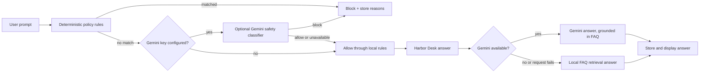

# Policy Guard Lab

Policy Guard Lab is a small prompt-injection safety demo for Harbor Desk, a fictional customer-support desk. Submit a message to see an explicit **allow** or **block** decision, the matched reasons, and—only for an allowed prompt—the support answer that follows. It is built with Laravel 13, Inertia, and Vue 3.

The point of the demo is the order of operations: deterministic rules run before any AI call, and a blocked prompt never reaches the answer model.

## How the AI path works



### Safety and reliability choices

- `App\Services\Guard\PolicyGuard` checks for instruction overrides, hidden-prompt disclosure, secret exfiltration, and common jailbreak phrases first.
- A deterministic match ends the request before classification or answer generation. Its reasons and `block` verdict are saved; `answer` remains `null`.
- When configured, Gemini provides an additional prompt classification and answers from a short Harbor Desk FAQ. Prompts are sent only to Google when `GEMINI_API_KEY` is set.
- All Gemini calls have a 12-second request timeout. If classification is unavailable, deterministic policy remains in effect; if answer generation fails, local FAQ retrieval supplies a response. Provider errors do not become unhandled 500 responses.
- With no key, the app binds `FakeLlmClient`: classification is skipped and allowed questions are answered using the local Harbor Desk FAQ. The fake is also used explicitly in tests.
- This is a learning demo, not a production security boundary. Safety filters can miss novel attacks; production systems should add monitoring, rate limits, red-team evaluation, and defense in depth.

## Run locally without an API key

Requirements: PHP 8.3+, Composer, Node.js 22+, and npm.

```bash
composer setup
php artisan db:seed
composer dev
```

Open <http://localhost:8000>. The default `.env.example` uses SQLite and requires no Redis, account, or external service. `composer setup` installs PHP dependencies, creates the local environment and app key, runs migrations, installs frontend dependencies, and builds assets. `composer dev` starts Laravel and Vite.

To use Gemini, set `GEMINI_API_KEY` in your untracked `.env` file and optionally set `GEMINI_MODEL` (default `gemini-2.5-flash`), then restart the app. Without the key, local rules and FAQ retrieval continue to work.

### Demo prompts

The seeder adds six sample prompts to the UI: three benign Harbor Desk FAQs and three example injection attempts. Seed with `php artisan db:seed`; there are no demo login credentials because the lab is open to guests. The customer-support brand and FAQ content are fictional.

## Tests and checks

```bash
php artisan test
composer lint:check
vendor/bin/phpstan analyse --memory-limit=512M
npm run check
npm run types:check
npm run build
```

The Pest feature suite verifies that a jailbreak is blocked before both classifier and answer calls, a benign refund question is allowed and stores its answer, guest submissions succeed, an optional classifier can block indirect injection, provider failures fall back to local retrieval, Gemini requests use the 12-second timeout, and the seeder creates the expected allow/block examples. Tests bind `FakeLlmClient`; no API key or network access is needed.

## Architecture

```text
app/
  Http/Controllers/GuardCheckController.php  Validate, inspect, and persist a check
  Models/GuardCheck.php                     Prompt, verdict, reasons, and answer
  Services/Guard/PolicyGuard.php             Deterministic-first policy decision
  Services/Guard/HarborDeskFaq.php            Local retrieval-only FAQ fallback
  Services/Llm/LlmClient.php                 Provider boundary
  Services/Llm/FakeLlmClient.php              No-key default and test fake
  Services/Llm/GeminiLlmClient.php            Optional Gemini provider
resources/js/pages/Welcome.vue               Prompt console and allow/block results
```

`POST /checks` accepts a JSON body such as `{"prompt":"What is your refund window?"}` and returns the verdict, reasons, answer (when allowed), and decision source. The home page shows the seeded examples and recent checks.
